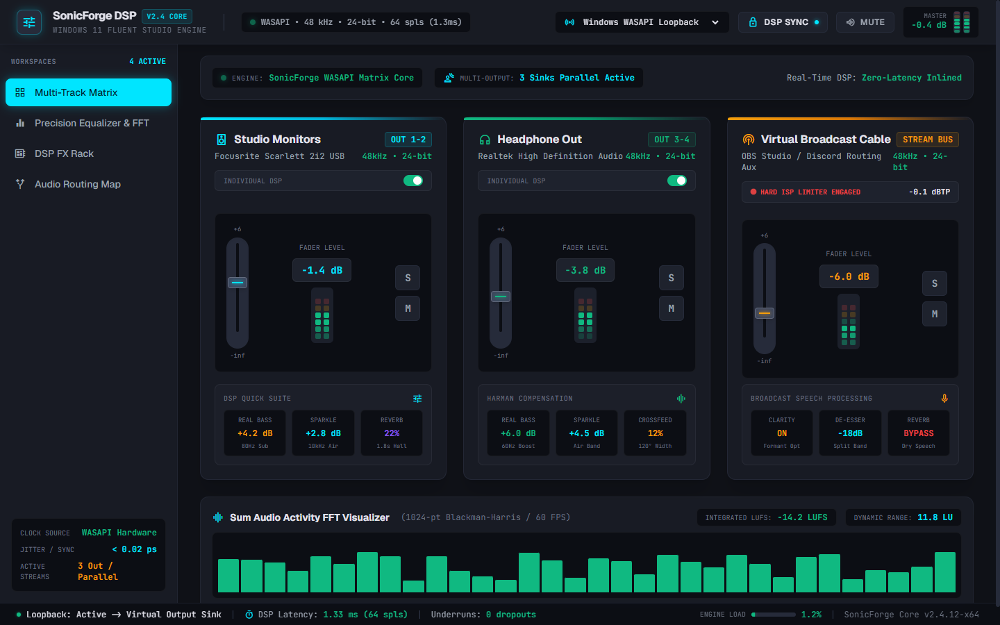
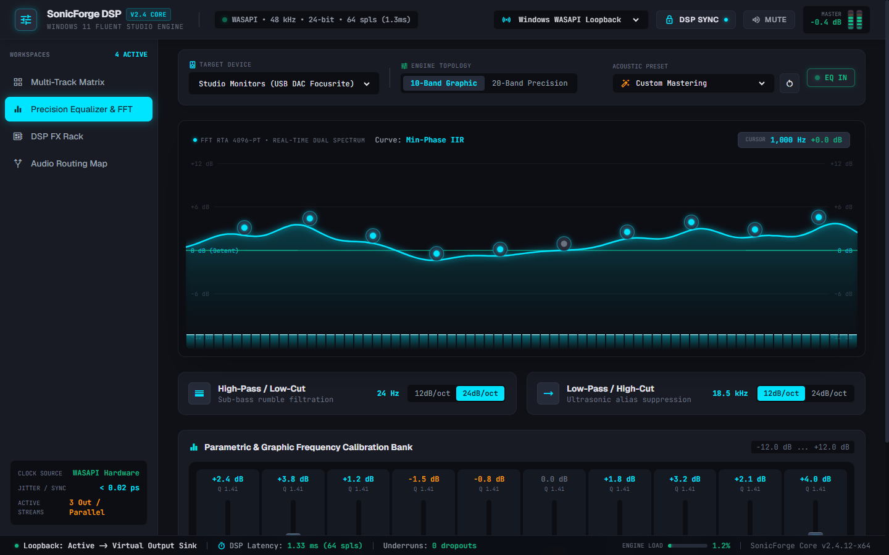
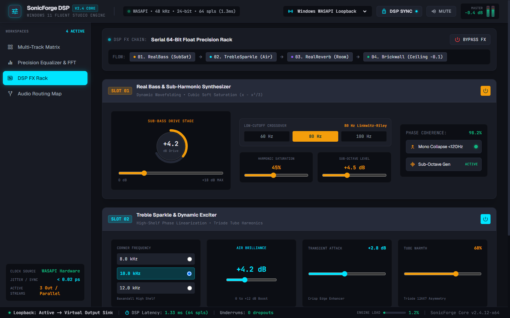
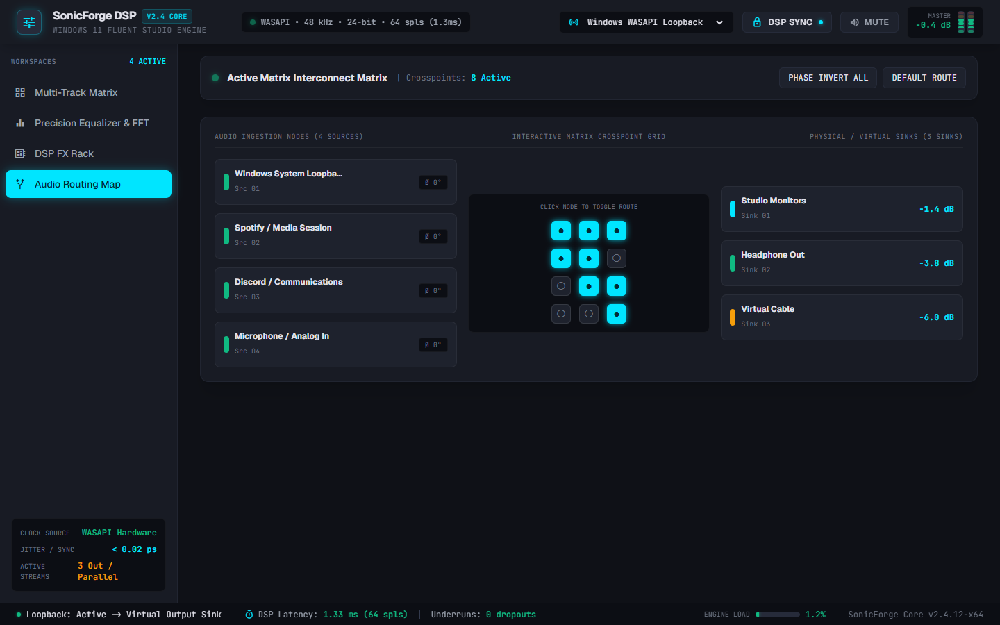
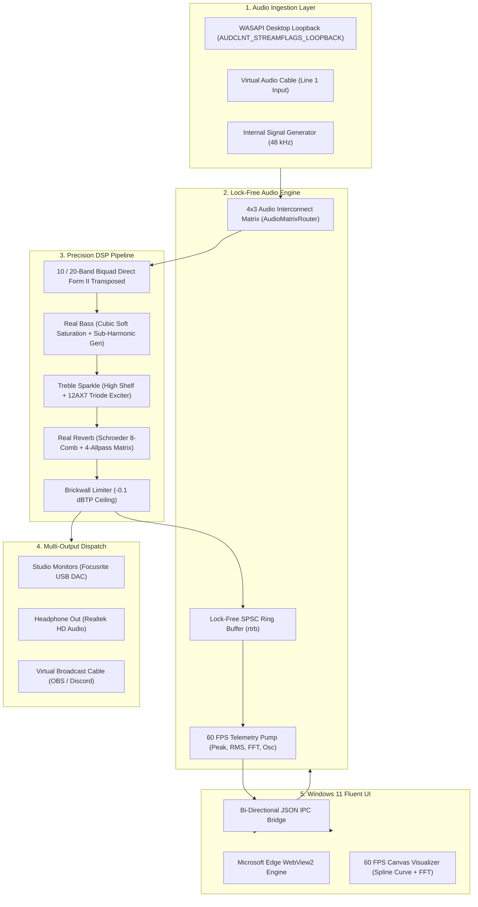

# SonicForge DSP - Windows Audio Matrix & DSP Control Center

[](https://www.rust-lang.org/)
[](https://microsoft.com)
[](LICENSE)

**SonicForge DSP** is a production-grade, standalone Windows desktop application for sound routing, multi-device mixing, 10/20-band graphic/parametric EQ, and master/per-channel audio effects with a real-time waveform oscilloscope visualizer.

Engineered with **Rust**, **WASAPI Core Audio APIs (`cpal`)**, and a **Windows 11 Fluent Studio Dark Aesthetic**, it adheres to real-time audio safety standards with lock-free atomic queues (`rtrb`) and non-blocking I/O.

---

## 📸 Interface Showcase

| Multi-Track Matrix | Precision Equalizer & FFT |
|:---:|:---:|
|  |  |

| DSP FX Rack | Audio Routing Map Patchbay |
|:---:|:---:|
|  |  |

---

## ✨ Features

- **Device Enumeration & Multi-Output Dispatch**:
  - Auto-enumerates all active Windows WASAPI playback endpoints (Speakers, Headphones, USB DACs, Virtual Audio Cables).
  - Parallel dispatch to 2 or more physical devices with independent volume faders (-inf to +6 dB), Solo, Mute, and Phase Inversion.
  - Windows Loopback capture (`AUDCLNT_STREAMFLAGS_LOOPBACK`) with fallback synthetic audio generator.
- **10-Band & 20-Band Graphic/Parametric Equalizer**:
  - Cascaded Direct Form II Transposed peaking IIR biquad filters.
  - Switchable 10-Band ISO Graphic EQ ($Q \approx 1.414$) and 20-Band Half-Octave Precision EQ ($Q \approx 2.87$).
  - High-Pass / Low-Cut and Low-Pass / High-Cut filters with selectable 12 dB/oct and 24 dB/oct slopes.
  - Built-in calibrated acoustic presets (`Flat`, `Bass Punch`, `Vocal Air`, `Loudness`).
- **Precision DSP Effects Rack**:
  - **Real Bass**: Low-shelf filter + normalized cubic soft saturation ($x - x^3 / 3$) + sub-octave flip-flop generator + 120 Hz mono collapse.
  - **Treble Sparkle**: Baxandall high-shelf exciter + 12AX7 triode tube harmonic saturation.
  - **Real Reverb**: Algorithmic Schroeder/Freeverb reverberator (8 parallel comb filters + 4 series allpass network).
  - **Brickwall Limiter**: True Peak limiting with calibrated `-0.1 dBTP` broadcast ceiling.
  - **DSP Sync Mode**: Synchronize DSP rack settings globally or unlock for per-device processing.
- **Real-Time Visualizer & Telemetry**:
  - 60 FPS continuous time-domain oscilloscope & dual FFT spectrum analyzer.
  - 32-bar and 72-bar ISO frequency spectrum monitors.
  - Dual-channel LED peak and RMS decibel meters.
  - Real-time buffer latency and dropout/underrun telemetry counters.
- **Thread Safety**:
  - Audio callback is 100% non-blocking: zero heap allocations, zero mutexes, lock-free SPSC ring buffers (`rtrb`).

---

## 🛠️ System Architecture



---

## 🚀 Getting Started

### Prerequisites
- Windows 10/11 (64-bit)
- [Rust & Cargo](https://rustup.rs/) (1.85+)
- Microsoft Edge WebView2 Runtime (pre-installed on Windows 10/11)

### Build & Run

```bash
# Clone the repository
git clone https://github.com/<username>/sonicforge-dsp.git
cd sonicforge-dsp

# Run native desktop application
cargo run --release

# Run headless pipeline verification
cargo run -- --verify-pipeline

# Run unit tests
cargo test
```

---

## 🧪 Testing

SonicForge DSP includes comprehensive automated unit tests covering mathematical stability, denormal immunity, limiter bounds, and device discovery:

```bash
cargo test
```

```
running 9 tests
test test_brickwall_limiter_ceiling ... ok
test test_biquad_nan_inf_immunity ... ok
test test_biquad_unit_circle_stability ... ok
test test_treble_sparkle_and_tube_warmth ... ok
test test_real_bass_soft_saturation ... ok
test test_equalizer_modes_and_presets ... ok
test test_matrix_router_dispatch ... ok
test test_reverb_schroeder_stability ... ok
test test_device_enumeration ... ok

test result: ok. 9 passed; 0 failed; 0 ignored; 0 measured; 0 filtered out; finished in 0.11s
```

---

## 📄 License

This project is licensed under the MIT License - see the [LICENSE](LICENSE) file for details.
