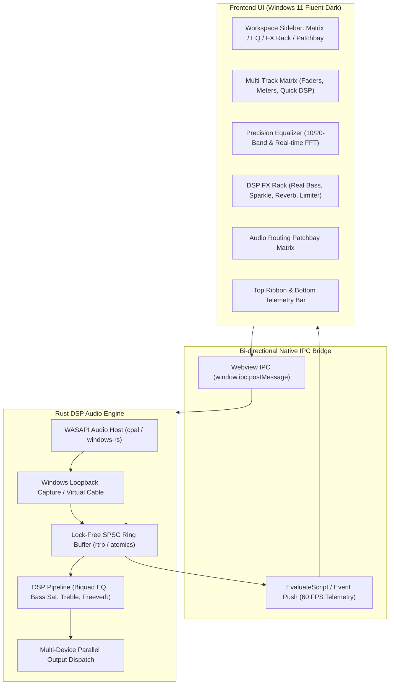

# Implementation Plan: SonicForge DSP - Windows Audio Matrix & DSP Control Center

SonicForge DSP is a production-grade, standalone Windows desktop application for sound routing, multi-device mixing, 10/20-band graphic/parametric EQ, and master/per-channel audio effects with a real-time waveform oscilloscope visualizer.

The user interface matches the Windows 11 Fluent Studio Dark aesthetic exported in `./design` (`#0F1117` carbon background, `#181B24` cards, Electric Cyan `#00E5FF`, Emerald `#10B981`, Warm Amber `#F59E0B`, and Spatial Violet `#8B5CF6` accents).

---

## 1. Architecture & Technology Stack

### Stack Components
- **Language**: Rust 1.99.1
- **Native Windowing & GUI**: `tao` (window management) + `wry` (Microsoft Edge WebView2 with hardware acceleration)
- **Audio I/O**: `cpal` + Windows WASAPI Core Audio APIs (Loopback capture `AUDCLNT_STREAMFLAGS_LOOPBACK`, multi-device endpoint enumeration, parallel render dispatch)
- **DSP Engine**: Custom Direct Form II Transposed cascaded biquad filters, $x - x^3/3$ soft-saturation harmonic synthesizer, Schroeder/Freeverb algorithmic reverberator, true-peak limiter
- **Concurrency**: Lock-free SPSC ring buffers (`rtrb`), atomics (`Arc<AtomicU32>`, `AtomicBool`) for lock-free parameter sharing between GUI and audio thread
- **Telemetry**: 60 FPS real-time peak/RMS metering, 1024-pt FFT spectrum analysis, oscilloscope wave buffer, buffer latency, and dropout counters

---

## 2. Proposed Changes & Implementation Steps

### Step 1: Project Setup & Dependencies
- Initialize Cargo project `sonicforge-dsp` at workspace root.
- Add dependencies in `Cargo.toml`:
  - `wry = "0.57"`, `tao = "0.37"`
  - `cpal = "0.18"`
  - `rtrb = "0.3"` (lock-free SPSC ring buffer)
  - `serde = { version = "1.0", features = ["derive"] }`, `serde_json = "1.0"`
  - `windows = { version = "0.62", features = ["Win32_Media_Audio"] }` (or WASAPI helpers)
  - `crossbeam-channel = "0.5"`

### Step 2: High-Performance DSP Audio Engine (`src/dsp/`)
- **`biquad.rs`**: Cascaded Direct Form II Transposed biquad peaking, low-shelf, high-shelf, high-pass, and low-pass filters with numerical stability guarantees ($|z| < 1$, NaN protection, denormal flushing).
- **`equalizer.rs`**:
  - 10-Band Graphic EQ (31 Hz, 63 Hz, 125 Hz, 250 Hz, 500 Hz, 1 kHz, 2 kHz, 4 kHz, 8 kHz, 16 kHz; $Q = 1.414$).
  - 20-Band Precision EQ (half-octave ISO spacing; $Q = 2.87$).
  - Presets: `Flat`, `Bass Punch`, `Vocal Air`, `Electronic / Loudness`, `Custom`.
  - Master Low-Cut (High-Pass) and High-Cut (Low-Pass) slope filters (12 dB/oct and 24 dB/oct).
- **`effects.rs`**:
  - `Real Bass`: Low-shelf filter (60–100 Hz cutoff) + sub-harmonic cubic wavefolder soft-saturation ($x - x^3 / 3$) + sub-octave synthesizer.
  - `Treble Sparkle`: High-shelf filter (8–12 kHz cutoff, 0 to +12 dB) + triode-style odd/even harmonic exciter.
  - `Real Reverb`: Algorithmic Freeverb/Schroeder 8 comb filters + 4 all-pass filters with Room Size, Decay (RT60), HF Damping, Pre-delay, and Wet/Dry blend.
  - `Brickwall Limiter`: True peak ceiling at -0.1 dBTP.
- **`matrix.rs`**: Multi-input to multi-output routing matrix with per-channel gain (-inf to +6 dB), Solo, Mute, and Phase Invert (0° / 180°).

### Step 3: WASAPI Loopback Capture, Multi-Device Output & Telemetry (`src/audio/`)
- **`engine.rs`**:
  - Enumerate active Windows WASAPI playback endpoints (Speakers, Headphones, DACs).
  - WASAPI loopback audio stream capture + test signal generator for environments without active loopback.
  - Dispatch audio stream to 2+ physical render devices simultaneously.
  - Strictly non-blocking audio callback: no heap allocations, no locks.
  - SPSC ring buffer for streaming oscilloscope frames and FFT telemetry to GUI.
  - Underrun / buffer latency telemetry tracker.

### Step 4: Windows 11 Fluent Studio Dark UI Integration (`src/ui/`)
- Assemble the Stitch mockups from `./design` into a comprehensive studio interface with 4 views:
  1. **Multi-Track Matrix**: Output device split cards (Studio Monitors, Headphone Out, Virtual Cable) with faders, peak ladders, solo/mute, quick DSP knobs, acoustic curve thumbnail, and collapsible FFT visualizer.
  2. **Precision Equalizer & Analyzer**: 10-band and 20-band fader bank with Q display, interactive canvas with 4096-pt FFT dual spectrum, RMS energy, and glowing EQ curve with draggable nodes.
  3. **DSP FX Rack**: Slots for Real Bass, Treble Sparkle, Real Reverb, and Brickwall Limiter with hardware faceplate styling and rotary dials.
  4. **Audio Routing Map**: Interactive patchbay matrix linking audio sources to DSP buses to physical sinks.
- Top control ribbon: Capture node selector, DSP Sync toggle, Master Mute, and stereo PPM/RMS meter.
- Bottom telemetry bar: Loopback status, underrun counter, engine load, and version.
- Bi-directional IPC handling between JS and Rust backend via `window.ipc.postMessage` and real-time state evaluation.

### Step 5: Verification & Automated Testing
- Unit tests for:
  - Biquad filter coefficient stability (poles inside unit circle).
  - Soft-saturation wavefolding ($x - x^3/3$).
  - Freeverb filter loop stability.
  - Lock-free ring buffer under high concurrency.
  - Device enumeration logic.
- Application test run:
  - Launch SonicForge DSP desktop window.
  - Capture window screenshot using PowerShell/Win32 APIs.
  - Verify visual parity with Stitch design and capture execution logs.

---

## 3. Verification Plan
- `cargo test`: Execute all DSP mathematical stability, ring buffer, and audio pipeline unit tests.
- `cargo run`: Run the desktop application, verify device enumeration and audio loopback stream.
- Capture a screenshot of the running application window and save to `./walkthrough_assets/sonicforge_app.png`.
- Produce `walkthrough.md` with complete architecture details, test results, and visual verification.
